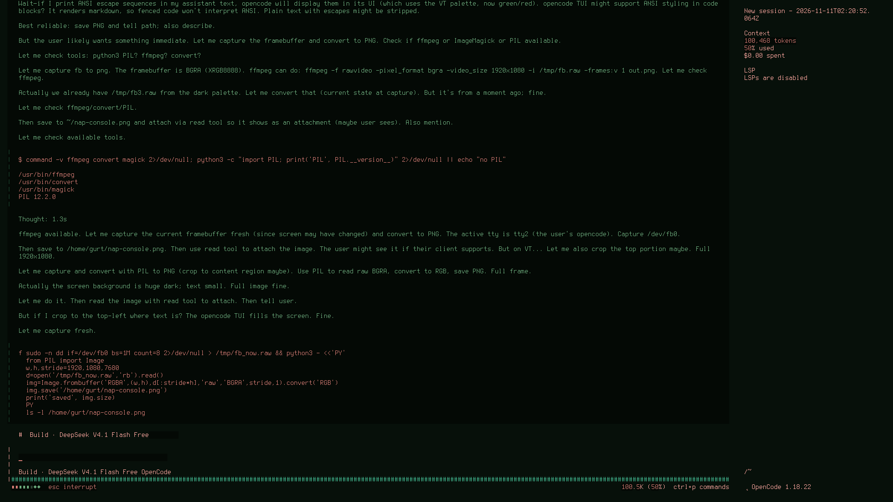

# Nap Mode

A low-power Linux console theme: a **dark green/red palette** on a VT plus matching
terminal + GUI themes. Inspired by the "nap" console on a Gurt/omarchy system — switch
to a spare VT, drop the desktop, and get a calm, power-saving look.



## What it does

- Loads a clean **Terminus16** font on a virtual terminal.
- Applies a 16-color **green + red** palette (`share/vtrgb`) via `setvtrgb`.
- Ships drop-in color themes for Kitty, Alacritty, Foot, Ghostty, btop, GTK, Waybar,
  Mako, Walker, SwayOSD, Hyprlock, and opencode.

## Quick start (any Linux)

```bash
git clone https://github.com/GurtTheOnly/nap-mode
cd nap-mode

# 1. Install the console helper + palette
sudo ./install.sh

# 2. Apply the font + palette to tty2 right now
sudo nap-console-style 2

# 3. Switch to it
Ctrl+Alt+F2

# 4. Return to the GUI
Ctrl+Alt+F1
```

### Optional: auto-apply on login

```bash
sudo ./install.sh --login-hook
```

This adds a snippet to your `~/.bash_profile`/`~/.profile` that runs
`nap-console-style 2` whenever a login shell starts on tty2, and adds a passwordless
sudoers rule so it can set the palette without a prompt.

### Palette swatches

```bash
nap-mode colors
```

Prints the 16-color palette as truecolor swatches.

### Re-tune the look

Edit `share/vtrgb` (16 lines of `#RRGGBB`):

```
#040905  #7a2a2a  #2d7a4a  #9a5f2f
#1f5237  #7d3240  #2d7a60  #6aa87a
#2f4535  #d13b3b  #3fae63  #d16a3a
#35a068  #d1506a  #3fb890  #d17a72
```

`color0`/`color8` are the darks, `color1`–`color7` are the base greens/reds, and
`color9`–`color15` are the brights. More red → shift the greens toward red; brighter →
push the darks toward `#000000` and the brights toward `#ffffff`.

### Fonts

The helper looks for a Terminus16 font in the usual console-font locations
(`/usr/share/kbd/consolefonts/Lat2-Terminus16.psfu.gz` on Arch, the Debian path too).
Install it with:

```bash
# Arch
sudo pacman -S terminus-font
# Debian/Ubuntu
sudo apt install fonts-terminus
# Fedora
sudo dnf install kbd-terminus-fonts
```

Set the font explicitly with `NAP_MODE_FONT=/path/to/font.psfu.gz sudo nap-console-style 2`.

## Terminal themes

Copy the matching theme into the app's config dir:

| App | File | Where to put it |
| --- | --- | --- |
| Kitty | `themes/kitty.conf` | `~/.config/kitty/kitty.conf` (or `include`) |
| Alacritty | `themes/alacritty.toml` | `~/.config/alacritty/alacritty.toml` |
| Foot | `themes/foot.ini` | `~/.config/foot/foot.ini` |
| Ghostty | `themes/ghostty.conf` | `~/.config/ghostty/config` |
| btop | `themes/btop.theme` | `~/.config/btop/btop.theme` |
| GTK 3/4 | `themes/gtk.css` | `~/.config/gtk-3.0/gtk.css` + `~/.config/gtk-4.0/gtk.css` |
| Waybar | `themes/waybar.css` | `~/.config/waybar/style.css` |
| Mako | `themes/mako.ini` | `~/.config/mako/config` |
| Walker | `themes/walker.css` | `~/.config/walker/style.css` |
| SwayOSD | `themes/swayosd.css` | `~/.config/swayosd/style.css` |
| Hyprlock | `themes/hyprlock.conf` | `~/.config/hypr/hyprlock.conf` |
| opencode | `themes/opencode-nap-mode.json` | `~/.config/opencode/themes/nap-mode.json` |

```bash
# example — Kitty
mkdir -p ~/.config/kitty
cp themes/kitty.conf ~/.config/kitty/kitty.conf
```

## Uninstall

```bash
sudo ./uninstall.sh
```

## License

[MIT](LICENSE)